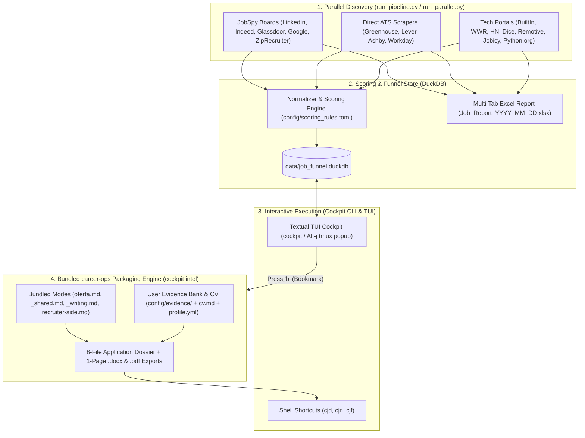

# Career Pipeline & Job Application Cockpit

Self-contained job discovery, funnel execution, and AI application packaging system. Combines **8 parallel job scrapers** (LinkedIn, Indeed, Glassdoor, Google, ZipRecruiter, Greenhouse/Lever/Ashby ATS boards, and tech portals), a local **DuckDB + Textual TUI Execution Cockpit**, and bundled **career-ops** 8-artifact dossier and 1-page `.docx`/`.pdf` resume & cover letter tailoring.

> [!IMPORTANT]
> **100% User-Agnostic & Self-Contained**: No personal resumes or candidate history are tracked in git, and no external `career-ops` repository is required. Clone the repo, run `./setup.sh`, and onboard with your own `.pdf`, `.docx`, or `.md` resumes via `cockpit onboard`.

---

## System Architecture



---

## 1. Quickstart (Clone & Run)

```bash
git clone https://github.com/ne1cc/career-pipeline.git
cd career-pipeline
./setup.sh
```

### What `./setup.sh` Does Automatically
1. **Bootstraps `uv` & Python 3.12 Virtual Environment**: Creates `.venv` and installs all Python dependencies from `cockpit/requirements.txt`.
2. **Installs Playwright Chromium**: Configures headless Chromium for pixel-perfect 1-page `.pdf` rendering (with an automatic native `%PDF-1.4` fallback if Chromium is skipped or unavailable).
3. **Seeds User-Layer Templates**: Copies clean starter templates into gitignored user paths (`config/evidence/`, `config/career_ops/cv.md`, `config/career_ops/config/profile.yml`, `pipeline_config.json`) without modifying tracked files.
4. **Initializes DuckDB & Compiles Base Resumes**: Creates `data/job_funnel.duckdb` and compiles starter `.docx` and `.pdf` resumes into `resumes/`.
5. **Installs CLI & Shell Shortcuts**: Symlinks `bin/cockpit` and `bin/tmux-jobcockpit` into `~/bin`, sources `shell/cockpit.sh` in `~/.zshrc` / `~/.bashrc`, and runs `cockpit doctor`.

### `setup.sh` Options

| Flag | Behavior |
| :--- | :--- |
| `./setup.sh` | Full turnkey install (venv, Chromium, starter templates, DuckDB init, `~/bin` symlinks, shell rc) |
| `./setup.sh --onboard` | Runs full setup and immediately launches the interactive `cockpit onboard` wizard |
| `./setup.sh --from-resumes <path>` | Imports your existing `.pdf`, `.docx`, or `.md` resume(s) during setup |
| `./setup.sh --no-browser` | Skips downloading Playwright Chromium (fast CI / headless mode) |
| `./setup.sh --no-shell` | Skips creating `~/bin` symlinks or modifying `~/.zshrc` / `~/.bashrc` |

---

## 2. Personalize With Your Resumes & Profile (`cockpit onboard`)

Bring your own `.pdf`, `.docx`, or `.md` resumes and configure your target roles, locations, and compensation floor:

```bash
# Option A: Import a single resume (.pdf, .docx, or .md) or a directory of resumes
cockpit onboard --from-resumes ~/Documents/My_Resume.pdf

# Option B: Interactive onboarding wizard (prompts for resume path, name, links, target roles & locations)
cockpit onboard

# Option C: Non-interactive onboarding via CLI flags
cockpit onboard \
  --from-resumes ~/resumes/ \
  --name "Jane Smith" \
  --email "jane@example.com" \
  --phone "+1-555-0123" \
  --location "Seattle, WA" \
  --linkedin "linkedin.com/in/janesmith" \
  --github "github.com/janesmith" \
  --roles "Software Engineer,Data Engineer,Analytics Engineer" \
  --locations "seattle,bellevue,remote,san francisco"
```

### Deep-Customizing Your Evidence Bank & Scoring Rules

After running `cockpit onboard`, you can refine your personal evidence bank (used by `cockpit intel` to select your top 3–4 matching projects and enforce zero-hallucination guardrails):

1. **`config/career_ops/cv.md`**: Your master CV in Markdown.
2. **`config/career_ops/config/profile.yml`**: Your candidate metadata, target archetypes, compensation bounds, and work authorization rules.
3. **`config/evidence/01_master_career_history.yaml`**: Verified employers, official job titles, allowed framing titles, dates, degrees, and verified work bullets.
4. **`config/evidence/02_project_evidence_bank.yaml`**: Your project catalog with stacks, repository/live URLs, verified metrics, and archetype tags (`swe_backend`, `data_eng`, `analytics_msba`).
5. **`config/evidence/03_skills_inventory.yaml`**: Verified technical skills categorized by evidence tier (`production`, `project`, `coursework`).
6. **`config/evidence/base_resumes/*.md`**: Markdown source resumes compiled into `resumes/*.docx` and `resumes/*.pdf` whenever you run:
   ```bash
   cockpit build-resumes
   ```
7. **`config/scoring_rules.local.toml`**: Optional local TOML overrides deep-merged on top of `config/scoring_rules.toml` (e.g., custom keyword weights, location boosts, YOE cap, or outreach message template).

### System Layer vs. User Layer Data Contract

All personal files are gitignored so your resumes, career history, and local overrides are never committed to git:

| Path | Layer | Tracked in Git? | Description |
| :--- | :---: | :---: | :--- |
| `config/templates/evidence/**` | System | Yes | Clean, generic starter templates for career history, projects, skills, and base resumes |
| `config/career_ops/modes/**` | System | Yes | Bundled `career-ops` prompts (`oferta.md`, `_shared.md`, `_writing.md`, `recruiter-side.md`, `hm-audit.md`) |
| `config/career_ops/templates/**` | System | Yes | HTML CV/cover-letter templates and Block G regulatory `.yml` tables |
| `config/scoring_rules.toml` | System | Yes | Default title archetypes, keyword weights, YOE disqualifiers, and penalties |
| `config/evidence/**` | **User** | **No** | Your personal career history YAML, project evidence bank, skills, and base resumes |
| `config/career_ops/cv.md` | **User** | **No** | Your master Markdown CV |
| `config/career_ops/config/profile.yml` | **User** | **No** | Your personal profile, target roles, and compensation floor |
| `config/career_ops/voice-dna.md` | **User** | **No** | Your writing voice and anti-AI-slop rules |
| `config/scoring_rules.local.toml` | **User** | **No** | Your personal scoring, location, and outreach template overrides |
| `resumes/*.{pdf,docx}` | **User** | **No** | Your imported or compiled archetype resumes staged for upload |

---

## 3. AI Application Packaging & Dossier Engine (`cockpit intel`)

When you bookmark a job in the TUI (press `b`) or run `cockpit intel`, the pipeline evaluates the posting against your background using the bundled `career-ops` prompt suite and writes a complete **8-file application package** plus **1-page `.docx` and `.pdf` exports** into `~/Documents/jobspy-cockpit/<Role> - <Company> - <Location> - <Date>/`:

| File | Purpose |
| :--- | :--- |
| `00_job_posting.md` | Original job description with YAML frontmatter (`dedup_key`, `priority_score`, `fit_score`, `apply_url`) |
| `01_fit_assessment.md` | Requirement-to-Evidence matrix (`FULL` / `PARTIAL` / `GAP`), top 3–4 project selection rationale, and `PRIORITIZE` \| `REASONABLE_STRETCH` \| `SKIP` verdict |
| `02_tailored_resume.md` | Tailored 1-page Markdown resume aligned to exact JD keywords using Google XYZ bullets |
| `03_cover_letter.md` | Concise 180–250 word cover letter citing 2 verified proof points with concrete metrics |
| `04_changelog_and_audit.md` | Bullet diff against base resume, ATS keyword coverage table, and anti-hallucination audit checklist |
| `05_interview_dossier.md` | Full `career-ops` Blocks A–G evaluation + Technical Hiring-Manager Playbook (unspoken JD translation, gap defense, study guide) |
| `06_outreach_and_pitch.md` | LinkedIn connection note (`≤280` chars), hiring manager cold email, and 45-second verbal pitch |
| `07_interview_drills_and_star.md` | 3 role-mapped STAR+T stories with Staff Engineer probe defenses + 2 role-specific technical/SQL/system drills |
| `exports/<Name>_Resume_<Company>_<Role>.{docx,pdf}` | Publication-ready, ATS-clean 1-page tailored resume in Word and PDF formats |
| `exports/<Name>_Cover_Letter_<Company>_<Role>.{docx,pdf}` | Matching formatted cover letter in Word and PDF formats |

### Configuring the LLM Backend (`claude-cli` or `gemini`)

`cockpit intel` supports two LLM backends configured in `config/scoring_rules.toml` (or overridden via `--provider` / `$LLM_PROVIDER`):

1. **Claude Code CLI (`provider = "claude-cli"`, default)**:
   - Uses your authenticated `claude` CLI (`claude -p --model sonnet`) with zero per-token API key setup required.
2. **Google Gemini API (`provider = "gemini"`)**:
   - Store your API key in the macOS login Keychain or set `$GEMINI_API_KEY`:
     ```bash
     cockpit keychain-setup --service gemini --run
     # Or export GEMINI_API_KEY="your-key"
     cockpit intel --provider gemini --model gemini-2.5-pro
     ```
   - If `claude` CLI is not installed and `GEMINI_API_KEY` is present, `cockpit intel` automatically falls back to Gemini.

---

## 4. Interactive TUI Cockpit & Shortcuts

Launch the TUI from any terminal:

```bash
cockpit
```

Or bind `bin/tmux-jobcockpit` to `Alt-j` in `~/.tmux.conf` for an instant floating popup:

```tmux
bind-key -n M-j run-shell "~/bin/tmux-jobcockpit '#{client_tty}'"
```

### TUI Keyboard Bindings

| Key | Action | Description |
| :---: | :--- | :--- |
| `Enter` / `o` | **Apply & Stage Resume** | Opens `apply_url` in browser and copies the tailored `.pdf` (or archetype `.pdf`) path to clipboard for `Cmd+Shift+G` upload |
| `b` | **Bookmark & Generate Package** | Saves the job (`is_saved = TRUE`) and triggers background `cockpit intel` 8-file dossier + `.docx`/`.pdf` generation |
| `a` | **Mark Applied** | Transitions job state to `APPLIED` and updates daily velocity counter |
| `s` | **Skip Job** | Transitions job state to `SKIPPED` |
| `h` | **Hold for Referral** | Places job in `HOLD_REFERRAL` (24h hold) and opens LinkedIn people search for the company |
| `c` | **Copy Cover Letter** | Copies the tailored cover letter `.pdf` path (or Markdown text) to clipboard |
| `p` | **Open Package Folder** | Reveals the job's generated artifact folder in Finder / file manager |
| `i` | **Open Interview Dossier** | Opens `05_interview_dossier.md` in default Markdown viewer |
| `e` | **Edit in Neovim** | Suspends TUI and opens the job's 4 core Markdown artifacts in `$EDITOR` / `nvim -p` |
| `r` | **QuickLook Resume** | Previews the staged resume PDF via macOS QuickLook (`qlmanage -p`) |
| `y` | **Copy Outreach Note** | Copies the tailored LinkedIn outreach note (or template fallback) to clipboard |
| `l` | **LinkedIn Referral Search** | Opens LinkedIn people search for the selected company in background |
| `n` | **Edit Notes** | Opens inline modal to attach custom notes to the job |
| `z` | **Undo** | Reverts the most recent status transition |
| `?` | **Keyword Search** | Filters table rows by company, title, or description |
| `/` | **Location Filter** | Filters jobs by location substring |
| `f` | **Cycle Status View** | Cycles through `QUEUED` → `SAVED` → `HOLD_REFERRAL` → `APPLIED` → `SKIPPED` → `ALL` |
| `g` | **Cycle Scraper Sheet** | Filters by scraper source segment |
| `t` | **Toggle 72h Filter** | Toggles between all queued jobs and postings discovered within the last 72 hours |
| `R` | **Sync Gmail Statuses** | Runs IMAP status sync to detect ATS confirmation, interview, or rejection emails |
| `q` | **Quit** | Closes the Cockpit TUI |

---

## 5. CLI Reference & Shell Jump Helpers

Sourcing `shell/cockpit.sh` (configured automatically by `./setup.sh`) provides instant shell jumps alongside the `cockpit` CLI:

### Shell Jump Functions (`shell/cockpit.sh`)

| Function | Equivalent CLI | Description |
| :--- | :--- | :--- |
| `cjd [query]` | `cd "$(cockpit folder [query])"` | `cd` directly into the matching job's dossier folder (or root export dir) |
| `cjn [query]` | `cockpit edit [query]` | Open the job's 4 core dossier Markdown files in Neovim tabs (`nvim -p`) |
| `cjf [query]` | `cockpit folder [query]` | Reveal the job's dossier folder in Finder / system file manager |
| `jobspy-pipeline` | `python run_pipeline.py` | Run the full parallel scraping + Excel workbook + Cockpit ingest pipeline |
| `jobspy-parallel` | `python run_parallel.py` | Run the 8 parallel scrapers standalone |

### `cockpit` CLI Commands

| Command | Description |
| :--- | :--- |
| `cockpit` / `cockpit tui` | Launch the interactive Textual TUI |
| `cockpit onboard [OPTIONS]` | Import user resumes (`--from-resumes`), run interactive profile wizard, or `--seed-defaults` |
| `cockpit build-resumes` | Compile `config/evidence/base_resumes/*.md` into `.docx` and `.pdf` in `resumes/` |
| `cockpit doctor` | Audit DuckDB, vendored `career-ops` prompts, user profile/CV, archetype resumes, LLM, and tmux |
| `cockpit init` | Initialize `data/job_funnel.duckdb` schema and tmux status cache |
| `cockpit ingest [PATHS...]` | Ingest JobSpy CSVs or Excel workbooks into DuckDB (auto-discovers latest `Job_Report_*.xlsx` if omitted) |
| `cockpit sprint [--limit N] [--recent]` | Launch sequential interactive CLI application sprint for top-scored queued jobs |
| `cockpit intel [--limit N] [--retry-failed]` | Generate 8-file dossiers and `.docx`/`.pdf` exports for bookmarked jobs |
| `cockpit dossier [QUERY] [--cat] [-v]` | List saved dossiers, print to terminal (`--cat`), or open in Neovim (`-v`) |
| `cockpit edit [QUERY]` | Open all core Markdown files for a saved job in `$EDITOR` / Neovim |
| `cockpit folder [QUERY]` / `cockpit artifacts` | Open a job's dossier directory in Finder / file manager |
| `cockpit pipeline [run\|status\|logs]` | Launch, monitor live progress, or inspect logs of the background scraper pipeline |
| `cockpit stats` | Display funnel conversion tables by resume archetype and job board |
| `cockpit sync-mail [--user EMAIL]` | Scan Gmail via IMAP to auto-update `APPLIED` → `INTERVIEW` / `REJECTED` / `OFFER` states |
| `cockpit keychain-setup` | Store Gmail app password (`--service gmail`) or Gemini API key (`--service gemini`) in macOS Keychain |
| `cockpit install-agent` | Install and bootstrap the macOS `launchd` scheduled sync agent |
| `cockpit tmux-status` | Print cached funnel velocity status line for `tmux` status bar |

---

## 6. Multi-Board Scraping Pipeline (`run_pipeline.py`)

Running `cockpit pipeline run` (or `jobspy-pipeline`) executes a 4-stage automated workflow:

1. **Step 1 — Parallel Scraping (`run_parallel.py`)**: Spawns 8 concurrent scraper tasks across JobSpy boards (`search_jobs_remote.py`, `search_jobs_seattle.py`, `search_jobs_seattle_entry_level.py`, `search_jobs_west.py`, `search_jobs_seattle_msba.py`, `search_jobs_msba_west.py`), direct ATS boards (`search_jobs_ats.py`), and tech portals (`search_jobs_portals.py`), with automatic retry on transient failures.
2. **Step 2 — Multi-Tab Excel Workbook**: Compiles discrete CSVs into `jobspy/scraped jobs/results/YYYY_MM/YYYY_MM_DD/Job_Report_YYYY_MM_DD.xlsx` with curated `Action Items`, `Last 72 Hours`, `Developer & Security`, and `New Since Last Run` tabs.
3. **Step 3 — Optional Email Delivery**: If `"email_enabled": true` and valid SMTP credentials are set in `pipeline_config.json`, emails the Excel report. When `"email_enabled": false` (the default on fresh clones), Step 3 is skipped cleanly without blocking ingestion.
4. **Step 4 — Cockpit DuckDB Ingest & Health Audit**: Deduplicates and scores all scraped jobs into `data/job_funnel.duckdb` and audits scraper yield against 14-day rolling averages.

### Portal Watch Mode

To poll fast-updating tech portals (We Work Remotely, Hacker News Jobs, Dice, Python.org, Built In, RemoteOK, Arbeitnow) continuously every 10 minutes without rebuilding the full Excel report:

```bash
.venv/bin/python jobspy/search_jobs_portals.py --watch --poll-interval 600
```

---

## 7. Testing & Verification

Run the full test suite (110 unit and integration tests across Cockpit, onboarding, exporters, scrapers, and pipeline monitoring):

```bash
.venv/bin/python -m pytest tests/ -v
```

**Additional Documentation:** [Cockpit Shortcuts Reference](docs/COCKPIT_SHORTCUTS.md) | [macOS LaunchAgent Guide](SETUP_MACOS.md) | [Proxy Configuration](PROXIES.md) | [Data Contract](config/career_ops/DATA_CONTRACT.md)
