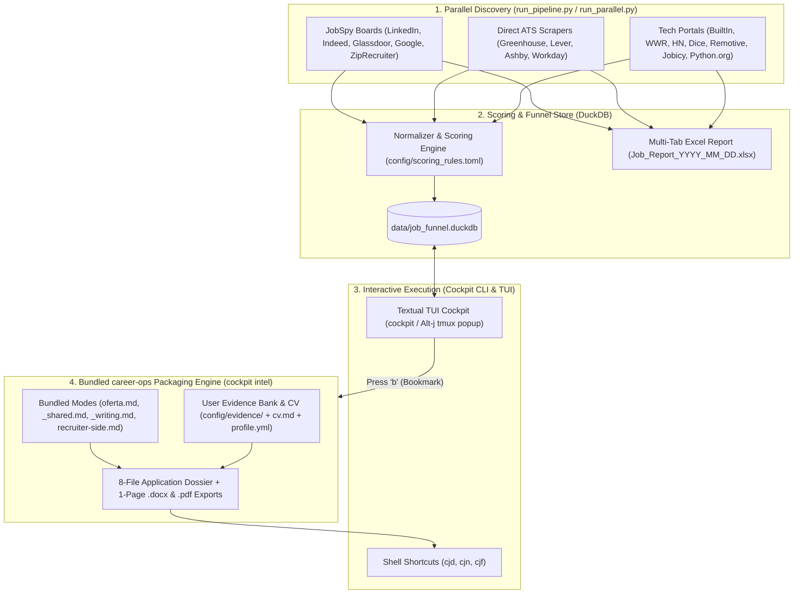

# Career Pipeline & Job Application Cockpit

Self-contained job discovery, funnel execution, and AI application packaging system. Combines **8 parallel job scrapers** (LinkedIn, Indeed, Glassdoor, Google, ZipRecruiter, Greenhouse/Lever/Ashby ATS boards, and tech portals), a local **DuckDB + Textual TUI Execution Cockpit**, and bundled **career-ops** 8-artifact dossier and 1-page `.docx`/`.pdf` resume & cover letter tailoring.

> [!IMPORTANT]
> **100% User-Agnostic & Self-Contained**: No personal resumes or candidate history are tracked in git, and no external `career-ops` repository is required. Clone the repo, run `./setup.sh`, and onboard with your own `.pdf`, `.docx`, or `.md` resumes via `cockpit onboard`.

---

## System Architecture



---

## Command Cheat Sheet

Every command, key and script in this repo, grouped by what you are trying to do. Use your browser's find (`Cmd+F`) to jump to a command.

**Contents:** [Daily routine](#daily-routine) · [Cockpit keys](#cockpit-keys-inside-the-tui) · [`cockpit` commands](#cockpit-commands-in-the-terminal) · [Shell shortcuts](#shell-shortcuts) · [Scrapers](#scraper-scripts) · [Setup scripts](#setup-and-helper-scripts)

### Daily routine

1. Scrape and load jobs: `cockpit pipeline run`, then `cockpit ingest`.
2. Open the cockpit: `cockpit` (or `Alt+j` in tmux). Move with `j`/`k`.
3. See what is out there: `T` shows how many jobs exist per role in your current view.
4. Mark the jobs you like: `space` on each row.
5. Generate their dossiers: `G` (3 at a time, in the background).
6. Apply: `A` fills the form for you to review (it generates the dossier first if needed). You press Submit.
7. Record it: `a` = applied, `s` = skip, `h` = hold for a referral.

### Cockpit keys (inside the TUI)

Open it with `cockpit`. Keys are case sensitive: `G` means Shift+g.

#### Move around

| Key | What it does |
|---|---|
| `j` / `k` (or `↓` / `↑`) | Next / previous job (dismissed jobs are skipped) |
| `J` / `K` | Scroll the job description down / up |
| `d` / `u` | Scroll the job description half a page down / up |
| `q` | Quit |

#### Choose which jobs you see

| Key | What it does |
|---|---|
| `f` / `F` | Next / previous tab: New → Viewed → Saved → Hold → Applied → Interviews → Closed → Dismissed → All. Tabs are exclusive stages with live counts |
| `t` `N` `E` | Filters that stack on any tab (shown on the second tab-bar row): last 72h, new grad, intern |
| `t` | Toggle last-72-hours / all queued |
| `g` | Cycle the scraper sheet (all → seattle → west → remote …) |
| `/` | Filter by location text (`wa`, `seattle`, `remote`). Blank clears |
| `D` | Filter by ingest date (`2026_11_02` or `11/02`). Blank clears |
| `w` | Filter by words in the job description (comma separated). Blank clears |
| `?` | Search company, title and description |
| `T` | Titles view: AI groups titles into roles and counts jobs per role in this view. Press `T` or `Esc` to cancel while it runs |

Inside the Titles view: `Enter` shows only that role's jobs, `x` cycles the tier filter, `a` asks the AI a question about the breakdown, `r` regroups, `Esc` closes.

#### Pick several jobs at once

| Key | What it does |
|---|---|
| `space` | Mark / unmark the row (shown with `●`) and move down |
| `Esc` | Clear all marks |
| `G` | **Generate dossiers** for every marked job (or the cursor job if none are marked). Runs 3 at a time on your own claude/agy account. More than 10 marked asks you to press `G` again to confirm |
| `o` / `O` | With marks: open every marked apply page in background tabs |
| `I` | With marks: re-run the AI evaluation for each marked job |
| `x` | With marks: dismiss all marked jobs |
| `S` | Skip all marked jobs (`z` undoes one at a time) |

#### Dossiers (AI application packages)

| Key | What it does |
|---|---|
| `b` | Save one job and generate its dossier in the background |
| `G` | Same, for all marked jobs (see above) |
| `I` | Re-run the AI evaluation for this job |
| `i` | Open the interview dossier |
| `e` / `v` | Edit the dossier files in Neovim |
| `F` | Open the job's folder in Finder |
| `c` | Copy the cover letter |
| `y` | Copy the outreach note |

#### Apply

| Key | What it does |
|---|---|
| `A` | **Autofill**: open the form in a separate browser and fill it. Queues the dossier first if needed. Never submits |
| `o` / `Enter` | Open the apply page and copy the resume path (`Cmd+Shift+G`, `Cmd+V`, `Enter` in the file picker) |
| `O` | Same, in a background tab |
| `P` | Copy ATS prefill text (Greenhouse / Ashby / Lever) |
| `p` | Preview the staged resume (QuickLook) |
| `1` / `2` / `3` | Switch resume type: swe_backend / data_eng / analytics_msba |

#### Record what happened

| Key | What it does |
|---|---|
| `a` | Mark **Applied** |
| `s` | Mark **Skipped** |
| `h` | **Hold** for a referral (asks for a note) |
| `x` | **Dismiss** a job you are not exploring (press again in the DISMISSED view to restore) |
| `z` | Undo the last status change |
| `n` | Edit your note on the job |
| `r` | Open a LinkedIn people search for the company |
| `R` | Sync Gmail to detect interview / rejection emails |

### `cockpit` commands (in the terminal)

Run `cockpit <command> --help` for every option. `[query]` means a company or role name.

#### Setup and health

| Command | What it does |
|---|---|
| `cockpit onboard` | Set up your resumes and profile (`--from-resumes PATH`, `--seed-defaults`, or flags such as `--name`, `--email`) |
| `cockpit import-resume FILE` | Import one resume (.pdf/.docx/.md) into your config |
| `cockpit build-resumes` | Build the base resumes into .docx and .pdf |
| `cockpit init` | Create the local database |
| `cockpit doctor` | Check the database, prompts, resumes and AI setup |
| `cockpit keychain-setup` | Store a Gmail app password or Gemini key in the macOS Keychain (`--service gmail\|gemini`) |
| `cockpit install-agent` | Install the 08:30 / 13:30 background sync |

#### Find and load jobs

| Command | What it does |
|---|---|
| `cockpit pipeline` | Show the live scraper monitor (`--run` start, `--watch` keep open, `--once` one snapshot) |
| `cockpit run` | Start the scrapers in the background and attach the monitor |
| `cockpit stop` | Stop a running scrape |
| `cockpit retry [scrapers]` | Re-run only the scrapers that failed |
| `cockpit ingest` | Load scraped results into the database (`--latest`, `--all-uningested`, `--date 11/02`, `--days N`, `--status`) |
| `cockpit bulk-ingest` | Load the last N days of results (`--days N`) |
| `cockpit rescore` | Re-score queued jobs with `scoring_rules.toml` (`--audit` shows why jobs were dropped) |
| `cockpit enrich` | Fetch full descriptions for the top short postings and re-score them |
| `cockpit verify-open` | Check whether apply links are still open (`--limit N`, `--all-queued`, `--dry-run`) |
| `cockpit stats` | Funnel numbers by resume type and job board |
| `cockpit tui` | Open the cockpit (same as `cockpit`) |
| `cockpit tmux-status` | Print the status line for the tmux bar |

#### Dossiers and applying

| Command | What it does |
|---|---|
| `cockpit intel` | Generate dossiers for saved jobs (`--limit N`, `--retry-failed`, `--provider claude-cli\|agy\|gemini`, `--stale-hours N`) |
| `cockpit sync-saved` | Match saved jobs to the dossier folders on disk |
| `cockpit dossier [query]` | List dossiers, or open one (`--cat` print, `-v` Neovim, `-m` One Markdown, `--latest`, `--select` fzf picker) |
| `cockpit edit [query]` / `nvim` | Open a dossier in Neovim |
| `cockpit md [query]` / `onemarkdown` | Open a dossier in One Markdown |
| `cockpit folder [query]` / `artifacts` | Open the dossier folder in Finder |
| `cockpit autofill URL\|KEY` | Fill one application form (`--pdf FILE`, `--cover FILE`). You submit. No AI-drafted answers here |
| `cockpit prefill URL\|KEY` | Print ATS prefill text (`--copy`, `--open`, `--json`) |
| `cockpit sprint` | Step through top jobs one by one in the terminal (`--limit`, `--recent`, `--segment`, `--location`) |
| `cockpit sync-mail` | Update APPLIED jobs from ATS emails in Gmail |
| `cockpit verify-ats FILE` | Score a resume for ATS parsing, 0-100 (`--all`, `--keywords`, `--role`, `--json`) |

### Shell shortcuts

Added to your shell by `./setup.sh` (from `shell/cockpit.sh`).

| Command | What it does |
|---|---|
| `cjd [query]` | `cd` into a job's dossier folder (no query: the root) |
| `cjn [query]` | Open a job's dossier files in Neovim |
| `cjf [query]` | Show a job's folder in Finder |
| `cjp [url\|query]` | Copy ATS prefill text |
| `cjv [resume]` | Check a resume for ATS parsing |
| `jobspy-pipeline` | Run the whole scrape → Excel → ingest pipeline |
| `jobspy-parallel` | Run only the parallel scrapers |
| `Alt+j` (tmux) | Open or close the cockpit popup, once `bin/tmux-jobcockpit` is bound (see section 4) |

### Scraper scripts

Run with `uv run python <script>`.

| Script | What it does |
|---|---|
| `run_pipeline.py` | Full pipeline: scrape, Excel report, optional email, ingest |
| `run_parallel.py` | All scrapers at once with automatic retry |
| `jobspy/search_jobs_seattle.py`, `_seattle_entry_level.py`, `_seattle_msba.py`, `_west.py`, `_msba_west.py`, `_remote.py` | One search sheet each (the names say the area or target) |
| `jobspy/search_jobs_ats.py` | Company career pages (Greenhouse, Lever, Ashby, …) |
| `jobspy/search_jobs_campus.py` | New-grad and campus lists |
| `jobspy/search_jobs_internships.py` | Internship sweep (`--smoke-test`, `--no-jobspy`, `--no-ats`, `--no-curated`) |
| `jobspy/search_jobs_portals.py` | Tech job portals (`--watch`, `--poll-interval SECONDS`, `--hours-old N`, `--smoke-test`) |

### Setup and helper scripts

| Command | What it does |
|---|---|
| `./setup.sh` | Full install (`--onboard`, `--from-resumes PATH`, `--no-browser`, `--no-shell`) |
| `bin/import-resume FILE` | Same as `cockpit import-resume` |
| `bin/tmux-jobcockpit` | The tmux popup launcher |
| `python -m pytest tests/` | Run the tests |

---

## 1. Quickstart (Clone & Run)

```bash
git clone https://github.com/ne1cc/career-pipeline.git
cd career-pipeline
./setup.sh
```

### What `./setup.sh` Does Automatically
1. **Bootstraps `uv` & Python 3.12 Virtual Environment**: Creates `.venv` and installs all Python dependencies from `cockpit/requirements.txt`.
2. **Installs Playwright Chromium**: Configures headless Chromium for pixel-perfect 1-page `.pdf` rendering (with an automatic native `%PDF-1.4` fallback if Chromium is skipped or unavailable).
3. **Seeds User-Layer Templates**: Copies clean starter templates into gitignored user paths (`config/evidence/`, `config/career_ops/cv.md`, `config/career_ops/config/profile.yml`, `pipeline_config.json`) without modifying tracked files.
4. **Initializes DuckDB & Compiles Base Resumes**: Creates `data/job_funnel.duckdb` and compiles starter `.docx` and `.pdf` resumes into `resumes/`.
5. **Installs CLI & Shell Shortcuts**: Symlinks `bin/cockpit` and `bin/tmux-jobcockpit` into `~/bin`, sources `shell/cockpit.sh` in `~/.zshrc` / `~/.bashrc`, and runs `cockpit doctor`.

### `setup.sh` Options

| Flag | Behavior |
| :--- | :--- |
| `./setup.sh` | Full turnkey install (venv, Chromium, starter templates, DuckDB init, `~/bin` symlinks, shell rc) |
| `./setup.sh --onboard` | Runs full setup and immediately launches the interactive `cockpit onboard` wizard |
| `./setup.sh --from-resumes <path>` | Imports your existing `.pdf`, `.docx`, or `.md` resume(s) during setup |
| `./setup.sh --no-browser` | Skips downloading Playwright Chromium (fast CI / headless mode) |
| `./setup.sh --no-shell` | Skips creating `~/bin` symlinks or modifying `~/.zshrc` / `~/.bashrc` |

---

## 2. Personalize With Your Resumes & Profile (`cockpit onboard`)

Bring your own `.pdf`, `.docx`, or `.md` resumes and configure your target roles, locations, and compensation floor:

```bash
# Option A: Import a single resume (.pdf, .docx, or .md) or a directory of resumes
cockpit onboard --from-resumes ~/Documents/My_Resume.pdf

# Option B: Interactive onboarding wizard (prompts for resume path, name, links, target roles & locations)
cockpit onboard

# Option C: Non-interactive onboarding via CLI flags
cockpit onboard \
  --from-resumes ~/resumes/ \
  --name "Jane Smith" \
  --email "jane@example.com" \
  --phone "+1-555-0123" \
  --location "City, State" \
  --linkedin "linkedin.com/in/janesmith" \
  --github "github.com/janesmith" \
  --roles "Software Engineer,Data Engineer,Analytics Engineer" \
  --locations "city-a,city-b,remote"
```

### Deep-Customizing Your Evidence Bank & Scoring Rules

After running `cockpit onboard`, you can refine your personal evidence bank (used by `cockpit intel` to select your top 3–4 matching projects and enforce zero-hallucination guardrails):

1. **`config/career_ops/cv.md`**: Your master CV in Markdown.
2. **`config/career_ops/config/profile.yml`**: Your candidate metadata, target archetypes, compensation bounds, and work authorization rules.
3. **`config/evidence/01_master_career_history.yaml`**: Verified employers, official job titles, allowed framing titles, dates, degrees, and verified work bullets.
4. **`config/evidence/02_project_evidence_bank.yaml`**: Your project catalog with stacks, repository/live URLs, verified metrics, and archetype tags (`swe_backend`, `data_eng`, `analytics_msba`).
5. **`config/evidence/03_skills_inventory.yaml`**: Verified technical skills categorized by evidence tier (`production`, `project`, `coursework`).
6. **`config/evidence/base_resumes/*.md`**: Markdown source resumes compiled into `resumes/*.docx` and `resumes/*.pdf` whenever you run:
   ```bash
   cockpit build-resumes
   ```
7. **`config/scoring_rules.local.toml`**: Optional local TOML overrides deep-merged on top of `config/scoring_rules.toml` (e.g., custom keyword weights, location boosts, YOE cap, or outreach message template).

### System Layer vs. User Layer Data Contract

All personal files are gitignored so your resumes, career history, and local overrides are never committed to git:

| Path | Layer | Tracked in Git? | Description |
| :--- | :---: | :---: | :--- |
| `config/templates/evidence/**` | System | Yes | Clean, generic starter templates for career history, projects, skills, and base resumes |
| `config/career_ops/modes/**` | System | Yes | Bundled `career-ops` prompts (`oferta.md`, `_shared.md`, `_writing.md`, `recruiter-side.md`, `hm-audit.md`) |
| `config/career_ops/templates/**` | System | Yes | HTML CV/cover-letter templates and Block G regulatory `.yml` tables |
| `config/scoring_rules.toml` | System | Yes | Default title archetypes, keyword weights, YOE disqualifiers, and penalties |
| `config/evidence/**` | **User** | **No** | Your personal career history YAML, project evidence bank, skills, and base resumes |
| `config/career_ops/cv.md` | **User** | **No** | Your master Markdown CV |
| `config/career_ops/config/profile.yml` | **User** | **No** | Your personal profile, target roles, and compensation floor |
| `config/career_ops/voice-dna.md` | **User** | **No** | Your writing voice and anti-AI-slop rules |
| `config/scoring_rules.local.toml` | **User** | **No** | Your personal scoring, location, and outreach template overrides |
| `resumes/*.{pdf,docx}` | **User** | **No** | Your imported or compiled archetype resumes staged for upload |

---

## 3. AI Application Packaging & Dossier Engine (`cockpit intel`)

When you bookmark a job in the TUI (press `b`) or run `cockpit intel`, the pipeline evaluates the posting against your background using the bundled `career-ops` prompt suite and writes a complete **8-file application package** plus **1-page `.docx` and `.pdf` exports** into `~/Documents/jobspy-cockpit/<Role> - <Company> - <Location> - <Date>/`:

| File | Purpose |
| :--- | :--- |
| `00_job_posting.md` | Original job description with YAML frontmatter (`dedup_key`, `priority_score`, `fit_score`, `apply_url`) |
| `01_fit_assessment.md` | Requirement-to-Evidence matrix (`FULL` / `PARTIAL` / `GAP`), top 3–4 project selection rationale, and `PRIORITIZE` \| `REASONABLE_STRETCH` \| `SKIP` verdict |
| `02_tailored_resume.md` | Tailored 1-page Markdown resume aligned to exact JD keywords using Google XYZ bullets |
| `03_cover_letter.md` | Concise 180–250 word cover letter citing 2 verified proof points with concrete metrics |
| `04_changelog_and_audit.md` | Bullet diff against base resume, ATS keyword coverage table, and anti-hallucination audit checklist |
| `05_interview_dossier.md` | Full `career-ops` Blocks A–G evaluation + Technical Hiring-Manager Playbook (unspoken JD translation, gap defense, study guide) |
| `06_outreach_and_pitch.md` | LinkedIn connection note (`≤280` chars), hiring manager cold email, and 45-second verbal pitch |
| `07_interview_drills_and_star.md` | 3 role-mapped STAR+T stories with Staff Engineer probe defenses + 2 role-specific technical/SQL/system drills |
| `exports/<Name>_Resume_<Company>_<Role>.{docx,pdf}` | Publication-ready, ATS-clean 1-page tailored resume in Word and PDF formats |
| `exports/<Name>_Cover_Letter_<Company>_<Role>.{docx,pdf}` | Matching formatted cover letter in Word and PDF formats |

### Configuring the LLM Backend (`claude-cli`, `agy`, or `gemini`)

`cockpit intel` supports three LLM backends configured in `config/scoring_rules.toml` (or overridden via `--provider` / `$LLM_PROVIDER`):

1. **Claude Code CLI (`provider = "claude-cli"`, default)**:
   - Uses your authenticated `claude` CLI (`claude -p --model sonnet`) with zero per-token API key setup required.
2. **Google Gemini API (`provider = "gemini"`)**:
   - Store your API key in the macOS login Keychain or set `$GEMINI_API_KEY`:
     ```bash
     cockpit keychain-setup --service gemini --run
     # Or export GEMINI_API_KEY="your-key"
     cockpit intel --provider gemini --model gemini-2.5-pro
     ```
   - If `claude` CLI is not installed and `GEMINI_API_KEY` is present, `cockpit intel` automatically falls back to Gemini.
3. **Antigravity CLI (`provider = "agy"`)**:
   - Uses your authenticated `agy` under your Antigravity account; `model` is any `agy models` id (default `gemini-4-argon-medium`, or `"default"` for your account default). The context and JD are handed over as files, since `agy -p` truncates text past ~45 KB. A full dossier takes about 6 minutes.

To use your own evaluation prompt instead of `modes/oferta.md`, set `[intel] prompt_file = "~/path/prompt.md"` (or `$INTEL_PROMPT_FILE`). The CV, profile, evidence bank and section/`SCORE_SUMMARY` output contract are still appended so dossiers keep parsing.

---

## 4. Interactive TUI Cockpit & Shortcuts

Launch the TUI from any terminal:

```bash
cockpit
```

Or bind `bin/tmux-jobcockpit` to `Alt-j` in `~/.tmux.conf` for an instant floating popup:

```tmux
bind-key -n M-j run-shell "~/bin/tmux-jobcockpit '#{client_tty}'"
```

### TUI Keyboard Bindings

See the [Cockpit keys](#cockpit-keys-inside-the-tui) tables in the Command Cheat Sheet above.

---

## 5. CLI Reference & Shell Jump Helpers

Sourcing `shell/cockpit.sh` (configured automatically by `./setup.sh`) provides instant shell jumps alongside the `cockpit` CLI:

### Shell Jump Functions (`shell/cockpit.sh`)

See [Shell shortcuts](#shell-shortcuts) in the Command Cheat Sheet above.

### Autofill (`A`)

Press `A` on a job to open its application form in a separate Chromium window with your contact details filled in, the tailored resume (else the base resume) attached, the cover letter pasted where the form has a text box, and your preset eligibility answers chosen. Supported sites: Greenhouse, Ashby and Lever. Any other site just opens in your everyday browser.

- **It never submits.** You review the page and press Submit yourself. It stops at CAPTCHAs and logins and leaves the tab open for you. Required questions it could not answer are outlined in orange.
- **Answers file:** `config/career_ops/config/answers.yml` (git-ignored; copy from `answers.example.yml`). Each rule is a `match` regex plus an `answer`. You must set these answers truthfully yourself; a question with no matching rule is left blank.
- **Separate browser profile:** `~/Library/Application Support/jobspy-cockpit/apply-profile`, so it shares no logins or cookies with your everyday browser. Log in once in that window if a site needs it.
- **Answers can be a list** for a "select all that apply" checkbox question; each item must match exactly one option, otherwise the whole question is left for you. Date answers must use the format the form shows (MM/YYYY, MM/DD/YYYY). Phrasing that names a company ("previously employed at Acme") needs its own per-company rule.
- **Report:** `needs you` lists required questions left blank; optional questions where a rule matched but no single option fit are listed separately as `unmatched`.
- **Not handled yet:** Greenhouse's "enter manually" cover letter, searchable school/university pickers (Lever), and LinkedIn / Indeed / Workday.
- **Dossier first.** If the job has no finished dossier, `A` stars it and queues one (3 dossiers generate at once on your own `claude`/`agy` account); the form opens and fills by itself when the dossier finishes, with the tailored resume and cover letter. A failed dossier shows a warning and opens nothing; press `A` again to retry. Jobs waiting to open are kept in memory, so quitting the cockpit drops that wait (the dossiers still finish; press `A` again and the form opens at once).
- **Drafted answers.** Empty free-text boxes (required ones, or worded as a question) get a first draft from your resume, dossier and job description, up to 8 per form. Drafts use only facts in those documents, are outlined in blue and listed as `drafted`; read and edit each one. A box the model cannot answer honestly stays blank. Drafts are not made by `cockpit autofill`.
- The same flow runs from the shell with `cockpit autofill <url|key>`.

### `cockpit` CLI Commands

See [`cockpit` commands](#cockpit-commands-in-the-terminal) in the Command Cheat Sheet above.

---

## 6. Multi-Board Scraping Pipeline (`run_pipeline.py`)

Running `cockpit pipeline run` (or `jobspy-pipeline`) executes a 4-stage automated workflow:

1. **Step 1 — Parallel Scraping (`run_parallel.py`)**: Spawns 8 concurrent scraper tasks across JobSpy boards (`search_jobs_remote.py`, `search_jobs_seattle.py`, `search_jobs_seattle_entry_level.py`, `search_jobs_west.py`, `search_jobs_seattle_msba.py`, `search_jobs_msba_west.py`), direct ATS boards (`search_jobs_ats.py`), and tech portals (`search_jobs_portals.py`), with automatic retry on transient failures.
2. **Step 2 — Multi-Tab Excel Workbook**: Compiles discrete CSVs into `jobspy/scraped jobs/results/YYYY_MM/YYYY_MM_DD/Job_Report_YYYY_MM_DD.xlsx` with curated `Action Items`, `Last 72 Hours`, `Developer & Security`, and `New Since Last Run` tabs.
3. **Step 3 — Optional Email Delivery**: If `"email_enabled": true` and valid SMTP credentials are set in `pipeline_config.json`, emails the Excel report. When `"email_enabled": false` (the default on fresh clones), Step 3 is skipped cleanly without blocking ingestion.
4. **Step 4 — Cockpit DuckDB Ingest & Health Audit**: Deduplicates and scores all scraped jobs into `data/job_funnel.duckdb` and audits scraper yield against 14-day rolling averages.

### Portal Watch Mode

To poll fast-updating tech portals (We Work Remotely, Hacker News Jobs, Dice, Python.org, Built In, RemoteOK, Arbeitnow) continuously every 10 minutes without rebuilding the full Excel report:

```bash
.venv/bin/python jobspy/search_jobs_portals.py --watch --poll-interval 600
```

### Dedicated Internship Scraper & Master's Eligibility Filter

For students and recent grads targeting Summer 2027 internships (analytics, MSBA/MSPA, data science, BI, and SWE):

```bash
# Run full sweep across JobSpy boards, ATS targets, SimplifyJobs, and Jobright
uv run python jobspy/search_jobs_internships.py

# Ingest scraped internship results into DuckDB
cockpit ingest

# Verify active status of apply links and prune closed roles
cockpit verify-open --limit 50
```

- **Undergraduate-Only Disqualification**: Postings specifying returning undergraduate requirements (e.g. rising juniors/seniors, bachelor's degrees only) are automatically flagged as `undergrad_only = True` and filtered out from the TUI `INTERN` view, surfacing graduate/master's-eligible roles.
- **TUI Internship View**: Press `E` in `cockpit` to filter to internships and view live, graduate-accessible internship postings.

---

## 7. Testing & Verification

Run the full test suite (110 unit and integration tests across Cockpit, onboarding, exporters, scrapers, and pipeline monitoring):

```bash
.venv/bin/python -m pytest tests/ -v
```

**Additional Documentation:** [Cockpit Shortcuts Reference](docs/COCKPIT_SHORTCUTS.md) | [macOS LaunchAgent Guide](SETUP_MACOS.md) | [Proxy Configuration](PROXIES.md) | [Data Contract](config/career_ops/DATA_CONTRACT.md)
