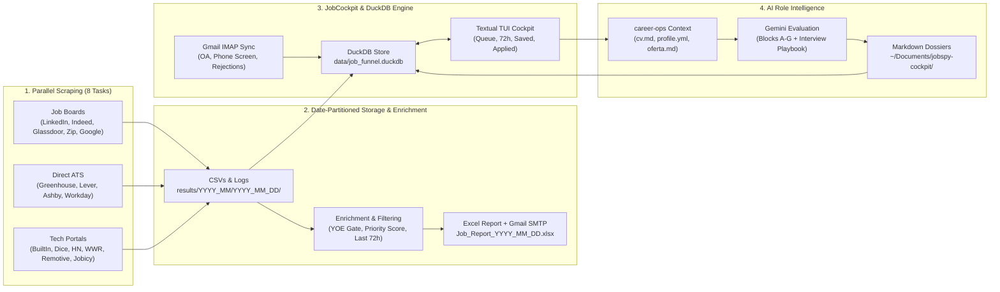

# JobSpy-Custom & JobCockpit: Capabilities & Product Requirements Document (PRD)

**Document Version:** 2.0  
**Date:** 2026-10-21  
**Repository:** `~/Github/ne1cc/Jobspy-Custom`  
**Companion Intelligence Repo:** `~/Github/ne1cc/career-ops`  
**Target Architecture:** Human-Reviewed AI Job Discovery, Evidence-Grounded Tailoring, Per-Job Packaging & Application Funnel Engine

---

## Executive Summary

**JobSpy-Custom + JobCockpit** is an end-to-end local-first job discovery, enrichment, intelligence, and application management engine built for macOS. 

- **Part I (Current Capabilities)** documents the production system already built: multi-source parallel scraping across 8 specialized segments, date-partitioned storage, YOE/seniority filtering, priority scoring, Excel digest delivery, DuckDB funnel persistence, Gmail IMAP status tracking, and Gemini-powered role dossiers.
- **Part II (Next-Phase PRD: Automated AI Application Packaging Engine)** specifies the upgrade from single-file Markdown dossiers to **per-job application folders** with **evidence-grounded AI resume tailoring, 180–250 word cover letter generation, requirement-to-evidence auditing, diff review, and immutable submission archival**—automating the manual workflow while keeping consequential human review gates intact.

---

# Part I: Current Pipeline Capabilities (As-Built Architecture)



## 1. Multi-Source Parallel Scraping Engine

Orchestrated by [`run_pipeline.py`](file:///Users/alex/Github/ne1cc/Jobspy-Custom/run_pipeline.py) and [`run_parallel.py`](file:///Users/alex/Github/ne1cc/Jobspy-Custom/run_parallel.py), the system spawns 8 concurrent scraper processes with automatic Python environment resolution and dependency preflight validation:

| Scraper Script | Output CSV | Target Scope & Sources |
| :--- | :--- | :--- |
| [`search_jobs_remote.py`](file:///Users/alex/Github/ne1cc/Jobspy-Custom/jobspy/search_jobs_remote.py) | `all_city_remote_jobs.csv` | US-wide remote Data, Analytics, BI, Product, SWE, and Security roles |
| [`search_jobs_seattle.py`](file:///Users/alex/Github/ne1cc/Jobspy-Custom/jobspy/search_jobs_seattle.py) | `seattle_jobs.csv` | Greater Seattle metro (Seattle, Bellevue, Redmond, Kirkland, Tacoma) |
| [`search_jobs_seattle_entry_level.py`](file:///Users/alex/Github/ne1cc/Jobspy-Custom/jobspy/search_jobs_seattle_entry_level.py) | `seattle_entry_level_jobs.csv` | Early-career, New Grad, Junior, and Associate roles in Seattle metro |
| [`search_jobs_west.py`](file:///Users/alex/Github/ne1cc/Jobspy-Custom/jobspy/search_jobs_west.py) | `west_coast_jobs.csv` | West Coast tech hubs (SF Bay Area, LA, San Diego, Portland, Denver, Phoenix) |
| [`search_jobs_seattle_msba.py`](file:///Users/alex/Github/ne1cc/Jobspy-Custom/jobspy/search_jobs_seattle_msba.py) | `seattle_msba_jobs.csv` | MSBA / graduate quantitative analytics track in Seattle |
| [`search_jobs_msba_west.py`](file:///Users/alex/Github/ne1cc/Jobspy-Custom/jobspy/search_jobs_msba_west.py) | `west_coast_msba_jobs.csv` | MSBA / graduate quantitative analytics track across West Coast hubs |
| [`search_jobs_ats.py`](file:///Users/alex/Github/ne1cc/Jobspy-Custom/jobspy/search_jobs_ats.py) | `ats_direct_jobs.csv` | Direct hosted ATS boards via `ats-scrapers` (Greenhouse, Lever, Ashby, Workday) |
| [`search_jobs_portals.py`](file:///Users/alex/Github/ne1cc/Jobspy-Custom/jobspy/search_jobs_portals.py) | `tech_portals_jobs.csv` | BuiltIn, Dice, Hacker News, WeWorkRemotely, Python.org, Remotive, Jobicy, Himalayas, RemoteOK, Arbeitnow (supports `--watch` 10-min daemon) |

### Operational Resilience & Date Partitioning
- **Date-Partitioned Run Storage**: Every run saves raw CSVs and scraper logs into `jobspy/scraped jobs/results/YYYY_MM/YYYY_MM_DD/` and `logs/YYYY_MM/YYYY_MM_DD/`, preserving historical daily snapshots without overwriting previous runs in the same month.
- **Self-Healing Interpreter Resolution**: [`resolve_pipeline_python()`](file:///Users/alex/Github/ne1cc/Jobspy-Custom/cockpit/pipeline_monitor.py#L362) automatically locates and validates the virtual environment containing `bs4` and `ats_scrapers` regardless of how the CLI was invoked.
- **Live TUI Pipeline Monitor**: `cockpit pipeline run` and `cockpit pipeline status --watch` render a real-time Rich dashboard tracking the 4 pipeline phases (`Scrapers → Excel Build → Email Delivery → Cockpit Ingest`), process PIDs, elapsed time, CSV sizes, and tail log activity.

---

## 2. Enrichment, Filtering & Daily Excel Digest

Implemented in [`pipeline_enrichment.py`](file:///Users/alex/Github/ne1cc/Jobspy-Custom/pipeline_enrichment.py) and [`run_pipeline.py`](file:///Users/alex/Github/ne1cc/Jobspy-Custom/run_pipeline.py):

1. **Cross-Run Novelty Tracking**: Compares job URLs against `.pipeline_state/previous_job_urls.json` to flag `is_new` listings and `is_fresh_post` (posted within 48–72 hours).
2. **Apply-Channel Classification**: Categorizes URLs into `Greenhouse Direct`, `Lever Direct`, `Ashby Direct`, `Workday Direct`, `LinkedIn Easy Apply`, or `Company Site`.
3. **Seniority & YOE Gate (`is_senior_or_high_yoe`)**: Automatically strips Senior, Staff, Principal, Lead, Manager, Director, III+ titles and descriptions requiring `5+` years of experience.
4. **Curated Priority Views**:
   - **`Last 72 Hours`**: Deduplicated feed of roles with verified timestamps in the last 72 hours, merging multi-board sources.
   - **`Action Items` (Fresher Spotlight)**: Early-career Data, Analytics, BI, and Product roles ranked by priority score (`is_new`, `is_fresh_post`, explicit entry-level tags, direct ATS bonus).
   - **`Developer & Security`**: Early-career Software, Backend, Full-Stack, Cloud, DevOps, and Cybersecurity/SOC roles.
5. **Automated Email Delivery**: Formats clickable hyperlinks, auto-sizes columns, highlights fresh rows, and emails `Job_Report_YYYY_MM_DD.xlsx` via Gmail SMTP.

---

## 3. JobCockpit Terminal Engine & DuckDB Store

Implemented in [`cockpit/cli.py`](file:///Users/alex/Github/ne1cc/Jobspy-Custom/cockpit/cli.py), [`cockpit/db.py`](file:///Users/alex/Github/ne1cc/Jobspy-Custom/cockpit/db.py), [`cockpit/normalizer.py`](file:///Users/alex/Github/ne1cc/Jobspy-Custom/cockpit/normalizer.py), and [`cockpit/tui.py`](file:///Users/alex/Github/ne1cc/Jobspy-Custom/cockpit/tui.py):

- **DuckDB State Store (`data/job_funnel.duckdb`)**:
  - Central `jobs_master` table keyed by normalized `dedup_key` (`company + title + location_bucket` or canonical URL).
  - Preserves application state across re-ingests so applied, skipped, or saved jobs are never clobbered.
- **Rule-Based Scoring & Archetype Routing (`config/scoring_rules.toml`)**:
  - Assigns each job a `priority_score` (`0–100`) and maps it to a base resume archetype (`swe_backend`, `data_eng`, `analytics`).
- **Interactive Textual TUI (`cockpit` / `Alt+Shift+j`)**:
  - Instant keyboard workflow: open URL + copy base resume path to clipboard (`o`/`O`), QuickLook PDF preview (`p`), switch resume archetype (`1`/`2`/`3`), mark Applied (`a`), Skip (`s`), Referral Hold (`h`), copy recruiter outreach message (`y`), save & trigger AI evaluation (`b`/`i`).
  - Interactive header sorting and tab filtering (`Queued`, `Recent 72h`, `Saved`, `Referral Hold`, `Applied`, `All`).
- **Automated Gmail IMAP Status Sync (`cockpit sync-mail`)**:
  - Polls Gmail for recruiter responses and automatically transitions jobs to `OA_RECEIVED`, `PHONE_SCREEN`, or `REJECTED`, firing native macOS notifications on positive signals.

---

## 4. AI Role Evaluation & Dossier Engine (`cockpit/intel.py`)

Implemented in [`cockpit/intel.py`](file:///Users/alex/Github/ne1cc/Jobspy-Custom/cockpit/intel.py):

- **Context Integration**: Reads candidate context from `~/Github/ne1cc/career-ops` (`cv.md`, `config/profile.yml`, `modes/oferta.md`, `modes/_shared.md`, `modes/_profile.md`).
- **Gemini Evaluation**: Evaluates saved postings using `google-genai` (`gemini-3.5-flash-lite` or `gemini-2.5-pro`) to produce:
  - Structured `Blocks A–G` evaluation and `SCORE_SUMMARY` (`fit_score` `0.0–5.0`, `archetype`, `legitimacy`).
  - **Staff/Hiring Manager Interview Prep Addendum**: Unspoken JD Translation, Industry "Taste" & Production Reality, Resume-to-Role Gap Analysis, Curated Study Guide, and Technical Interview Playbook.
- **Dossier Export & Reconciliation**:
  - Writes Markdown dossiers to `~/Documents/jobspy-cockpit/{Title} - {Company} - {Location} - {Date}.md` and maintains `index.md`.
  - `reconcile_saved_jobs()` self-heals DuckDB state from frontmatter on disk.

---
---

# Part II: Product Requirements Document (PRD) — Automated AI Application Packaging Engine

## 1. Problem Statement & Vision

### Current Gap
While JobCockpit currently automates **discovery, scoring, fit evaluation (`Blocks A–G`), and static PDF path copying**, the last mile of creating the application package is still either static (picking one of 3 fixed PDFs) or manual (copying the JD into an external chat workspace to draft a tailored resume and cover letter, manually checking for hallucinated claims, and manually organizing files).

### Target Workflow (Human-Reviewed Automation)
Transform JobCockpit from a single-file dossier generator into a **human-reviewed application packaging pipeline**:

```text
Save Job in Cockpit (key: b / i)
  ↓
[Stage 1: Snapshot] Create Per-Job Application Folder & Save Immutable JD + Metadata
  ↓
[Stage 2: Fit Gate] Map Requirements → Verified Evidence Bank (Prioritize | Stretch | Skip)
  ↓
[Stage 3: Draft] Select Closest Base Resume + Generate Tailored Resume, Cover Letter (180–250w), Change Log & Gap Audit
  ↓
[Stage 4: Review Gate] Inspect Diff & Fact-Check Audit in TUI / Markdown before Approving
  ↓
[Stage 5: Export & Stage] Compile Fixed-Template Resume PDF + Cover Letter PDF & Copy Path for Simplify Copilot
  ↓
[Stage 6: Archive] Lock Submitted Package as Immutable & Track Status via DuckDB + Gmail Sync
```

---

## 2. Core Architecture & Design Principles

1. **Evidence-Grounded, Zero-Fabrication Guarantee**:
   - The AI drafter **must never** use a single 1-page resume as its sole source, nor may it invent tools, metrics, employers, dates, or credentials.
   - All tailoring draws strictly from a structured **Verified Career Evidence Bank** that separates completed work from planned features and distinguishes paid employment, academic projects, and coursework.
2. **One Folder Per Application (`Application ID`)**:
   - Every saved/packaged job gets a deterministic, human-readable folder under `~/Documents/jobspy-cockpit/applications/{application_id}/` containing the frozen JD, fit assessment, tailored drafts, diff/change log, exported PDFs, and submission record.
3. **Diff-First Human Review Gate**:
   - AI outputs are staged as `DRAFT` first. The user reviews a structured **Change Log & Fact-Check Checklist** (highlighting exact bullet selections and wording changes against the base resume) before promoting the package to `APPROVED` / `SUBMITTED`.
4. **Seamless Simplify Copilot Hand-off**:
   - Once approved, pressing `o` in Cockpit opens the job application URL in the browser and copies the **job-specific tailored resume path** (and cover letter path) to the macOS clipboard so Simplify Copilot + `Cmd+Shift+G` attaches the exact tailored file in 2 seconds.

---

## 3. Component 1: Verified Career Evidence Bank Specification

Instead of relying solely on a flat `cv.md`, the evidence repository resides inside `Jobspy-Custom/config/evidence/` and is structured into four canonical source documents plus base resume templates:

### 3.1 Four Canonical Source Documents (`Jobspy-Custom/config/evidence/`)

| File Path | Purpose & Schema |
| :--- | :--- |
| `config/evidence/01_master_career_history.yaml` | Immutable record of actual employers, exact job titles, start/end dates, locations, degree credentials, and verified bullet bank with metric citations. |
| `config/evidence/02_project_evidence_bank.yaml` | Structured entries per project (`problem`, `intended_user`, `my_contribution`, `data_sources`, `tools_actually_used`, `features_completed`, `data_quality_checks`, `verified_scale_or_results`, `repo_url`, `limitations`, `planned_not_completed`). |
| `config/evidence/03_skills_inventory.yaml` | Categorized skills explicitly tagged by proficiency tier: `production_work`, `completed_project`, `graduate_coursework`, `introductory_familiarity`, and `not_used`. |
| `config/evidence/04_writing_and_application_rules.md` | Non-negotiable constraints: fixed facts (titles, dates, metrics), prohibited claims, tone rules (no generic fluff/praise), 1-page constraint, and cover letter word limits (`180–250` words). |

### 3.2 Base Resume Archetypes (`Jobspy-Custom/config/templates/`)

| Archetype Key | Base Template | Foregrounded Evidence |
| :--- | :--- | :--- |
| `data_bi_analyst` | `config/templates/base_data_bi_analyst.docx` | SQL, KPI reporting, dashboards, business metrics, experimentation, stakeholder communication |
| `analytics_data_engineer` | `config/templates/base_analytics_engineer.docx` | Data modeling, dbt/SQL transformations, automated data quality testing, lakehouse/ETL pipelines, reproducibility |
| `healthcare_life_sciences` | `config/templates/base_healthcare_analyst.docx` | Clinical trials intelligence, SDOH/healthcare datasets, biostatistics/epidemiological rigor, regulatory/research context |
| `swe_security` | `config/templates/base_swe_backend.docx` | Backend APIs, Python/TypeScript/Go services, cloud infrastructure, application security |

---

## 3.3 Claude Integration Architecture (`cockpit/intel.py` & `cockpit/packager.py`)

The generator interface in [`cockpit/intel.py`](file:///Users/alex/Github/ne1cc/Jobspy-Custom/cockpit/intel.py) uses a clean `Callable[[str, str], str]` contract `(system_prompt, user_content) -> response_text`. Claude is supported via two interchangeable backends configured in `config/scoring_rules.toml`:

1. **Mode A: Claude Code CLI Bridge (`provider = "claude-cli"`, Recommended — Zero Extra API Cost)**
   - Uses your authenticated `/opt/homebrew/bin/claude` CLI (`claude.ai` Pro subscription already logged in on this Mac).
   - Invokes non-interactive print mode with tools disabled and no session bloat:
     ```python
     subprocess.run(
         [
             "/opt/homebrew/bin/claude",
             "-p",
             "--model", model_name,          # "sonnet" (claude-sonnet-4-6) or "opus" (claude-opus-4-7)
             "--system-prompt", system_prompt,
             "--tools", "",                  # pure text generation, zero tool side effects
             "--no-session-persistence",     # do not clutter ~/.claude/projects transcripts
         ],
         input=user_content,
         text=True,
         capture_output=True,
         check=True,
     )
     ```
2. **Mode B: Direct Anthropic Python SDK (`provider = "anthropic-api"`)**
   - Uses `anthropic.Anthropic(api_key=...)` reading from macOS Keychain (`jobcockpit-claude`) or `$ANTHROPIC_API_KEY` with prompt caching (`cache_control={"type": "ephemeral"}`) on the Evidence Bank system prompt so repeated runs cost ~90% less on input tokens.

---

## 4. Component 2: Per-Job Application Folder Structure

When a job is saved or queued for packaging, the system assigns a deterministic `application_id` (`YYYY-MM-DD_{company_slug}_{role_slug}_{req_id_or_hash6}`) and scaffolds a dedicated directory:

```text
~/Documents/jobspy-cockpit/applications/
└── 2026-10-21_stripe_analytics-engineer_a8f92c/
    ├── 00_job_posting.md              # Frozen full JD text, URL, req ID, salary, location, metadata
    ├── 01_fit_assessment.md           # Requirement-to-Evidence table + Verdict (Prioritize | Stretch | Skip)
    ├── 02_tailored_resume.md          # Structured tailored resume content (derived from closest base)
    ├── 03_cover_letter.md             # 180-250 word grounded cover letter with 2 verified examples
    ├── 04_changelog_and_audit.md      # Bullet diff vs. base resume, gap list, and human review checklist
    ├── 05_interview_dossier.md        # Staff/HM Technical Interview Playbook (Blocks A-G + 5-part addendum)
    ├── exports/
    │   ├── Alex_Sun_Resume_Stripe_Analytics_Engineer.pdf
    │   ├── Alex_Sun_Resume_Stripe_Analytics_Engineer.docx
    │   └── Alex_Sun_Cover_Letter_Stripe_Analytics_Engineer.pdf
    └── submission_manifest.json       # Immutable lockfile recorded when marked APPLIED (hashes, date, answers)
```

---

## 5. Functional Requirements (EARS Specification)

### FR-1: Job Snapshot & Folder Initialization
- **FR-1.1**: **When** the user saves a job (`b`) or triggers application packaging (`g`) in JobCockpit, **the system shall** generate a unique `application_id` (`{date}_{company}_{role}_{req_id}`) and create the per-job folder under `~/Documents/jobspy-cockpit/applications/{application_id}/`.
- **FR-1.2**: **When** creating the per-job folder, **the system shall** write `00_job_posting.md` containing the immutable full job description text, company name, role title, job URL, requisition ID (extracted from URL/text), location, work arrangement, listed compensation, and timestamp saved.

### FR-2: Stage 1 — AI Requirement-to-Evidence Fit Gate
- **FR-2.1**: **When** evaluating a saved job, **the system shall** extract explicit eligibility gates (work authorization, degree, location, YOE) and core technical/domain requirements from `00_job_posting.md`.
- **FR-2.2**: **The system shall** map every extracted requirement against the 4 source files in the Verified Career Evidence Bank and generate `01_fit_assessment.md` containing a structured table with columns: `Requirement`, `Verified Evidence from Background`, and `Assessment` (`Direct Evidence`, `Adjacent Evidence`, or `Gap — Do Not Add`).
- **FR-2.3**: **The system shall** classify the role into one of three actionable fit categories—`PRIORITIZE`, `REASONABLE_STRETCH`, or `SKIP`—with explicit justification, and store `fit_category` and `main_gaps` in DuckDB.
- **FR-2.4**: **If** a role is classified as `SKIP` (e.g., hard eligibility blocker or critical unbridgeable gap), **the system shall** halt automatic document drafting unless the user explicitly overrides the gate (`--force`).

### FR-3: Stage 2 — Evidence-Grounded Resume Tailoring & Cover Letter Drafting
- **FR-3.1**: **Where** a job passes the Fit Gate (`PRIORITIZE` or `REASONABLE_STRETCH`), **the system shall** select the closest base resume template (`data_bi_analyst`, `analytics_data_engineer`, `healthcare_life_sciences`, or `swe_security`).
- **FR-3.2**: **The system shall** generate `02_tailored_resume.md` by selecting, reordering, and rephrasing only verified bullets from the Evidence Bank while keeping all employers, historical titles, dates, degree credentials, and numerical metrics strictly unchanged.
- **FR-3.3**: **The system shall** enforce the `planned_not_completed` boundary so that planned project features are never phrased as completed implementation.
- **FR-3.4**: **The system shall** generate `03_cover_letter.md` constrained to `180–250` words (unless employer instructions specify otherwise), incorporating two concrete verified examples from the Evidence Bank and a company-specific connection grounded strictly in the provided posting.

### FR-4: Stage 3 — Automated Fact-Check Audit & Diff Generation
- **FR-4.1**: **When** drafting completes, **the system shall** generate `04_changelog_and_audit.md` containing:
  1. A **Unified Diff / Bullet Change Log** showing exact additions, removals, and rephrasings relative to the selected base resume.
  2. A **Automated Hallucination Check** verifying that no out-of-inventory tools, altered dates, or unverified metrics appear in `02_tailored_resume.md` or `03_cover_letter.md`.
  3. A **Gaps & Screening Review List** highlighting missing qualifications and consequential application questions requiring manual human answers.

### FR-5: Stage 4 — Fixed-Template Export & Simplify Copilot Staging
- **FR-5.1**: **When** the draft package is generated (or updated by the user), **the system shall** compile `02_tailored_resume.md` and `03_cover_letter.md` into clean, fixed-layout `.pdf` and `.docx` files inside `exports/` with verified page breaks and active hyperlinks.
- **FR-5.2**: **When** the user presses `o` (Open & Stage) on a packaged job in the Cockpit TUI, **the system shall** copy the job-specific tailored resume PDF path (`exports/..._Resume_...pdf`) to the macOS clipboard, open the application URL in the default browser, and provide a 1-key toggle (`c`) to copy the tailored cover letter PDF path.

### FR-6: Stage 5 — Immutable Submission Lock & Tracker Persistence
- **FR-6.1**: **When** the user marks a job as `APPLIED` (`a`) in JobCockpit, **the system shall** write `submission_manifest.json` inside the job folder recording the SHA-256 hashes of the submitted resume and cover letter, submission timestamp, resume archetype used, and any recorded screening answers, and mark the exported PDFs as read-only (`chmod 444`).
- **FR-6.2**: **The system shall** update the DuckDB `jobs_master` tracker row with `application_id`, `role_family`, `fit_category`, `main_gaps`, `package_status` (`DRAFT`, `APPROVED`, `SUBMITTED`), `resume_version_path`, `cover_letter_path`, `applied_at`, `referral_contact`, `next_action`, and `next_action_date`.

---

## 6. DuckDB Tracker Schema Evolution (`jobs_master`)

To support the full human-reviewed workflow in a single source of truth, `jobs_master` in [`cockpit/db.py`](file:///Users/alex/Github/ne1cc/Jobspy-Custom/cockpit/db.py) shall be extended with the following columns (via idempotent `ALTER TABLE ... ADD COLUMN IF NOT EXISTS` migrations):

| Column | Type | Description |
| :--- | :---: | :--- |
| `application_id` | `VARCHAR` | Human-readable folder slug (`2026-10-21_company_role_reqid`) |
| `requisition_id` | `VARCHAR` | Extracted employer requisition ID if present |
| `role_family` | `VARCHAR` | `data_bi_analyst` \| `analytics_data_engineer` \| `healthcare_life_sciences` \| `swe_security` |
| `fit_category` | `VARCHAR` | `PRIORITIZE` \| `REASONABLE_STRETCH` \| `SKIP` |
| `main_gaps` | `VARCHAR` | Comma-separated summary of missing qualifications identified in Stage 1 |
| `package_status` | `VARCHAR` | `NONE` \| `FOLDER_CREATED` \| `FIT_CHECKED` \| `DRAFTED` \| `APPROVED` \| `SUBMITTED` |
| `folder_path` | `VARCHAR` | Absolute path to `~/Documents/jobspy-cockpit/applications/{application_id}/` |
| `tailored_resume_path` | `VARCHAR` | Path to compiled tailored resume PDF in `exports/` |
| `cover_letter_path` | `VARCHAR` | Path to compiled tailored cover letter PDF in `exports/` |
| `next_action` | `VARCHAR` | Next scheduled follow-up action (e.g., `Follow up with HM`, `Complete OA`) |
| `next_action_date` | `DATE` | Due date for `next_action` |
| `outcome_reason` | `VARCHAR` | Recorded outcome context (`unknown` by default unless explicit feedback received) |

---

## 7. CLI & TUI User Experience Additions

### 7.1 New CLI Commands (`cockpit`)

```bash
# Initialize and validate the 4 Career Evidence Bank files
cockpit evidence check

# Run the full packaging pipeline (Folder -> Fit Check -> Tailor Resume & Cover Letter -> Export PDFs)
cockpit package <dedup_key_or_saved> [--force] [--model gemini-2.5-pro]

# Open the diff & audit review for a drafted job package in $EDITOR / QuickLook
cockpit review <application_id>

# Approve a drafted package and stage the tailored PDF path to clipboard
cockpit approve <application_id>
```

### 7.2 New TUI Keybindings (`cockpit` Popup)

| Key | Action in TUI |
| :---: | :--- |
| `b` | **Save & Package**: Create job folder, run Fit Assessment + Tailored Resume + Cover Letter + Dossier in background |
| `d` | **Review Diff & Audit**: Open `04_changelog_and_audit.md` and `01_fit_assessment.md` in split preview |
| `p` | **Preview Resume PDF**: Launch macOS QuickLook (`qlmanage -p`) on the tailored resume PDF (falls back to base PDF) |
| `c` | **Copy Cover Letter Path**: Copy compiled cover letter PDF path to clipboard for file upload dialog |
| `o` | **Stage & Open**: Copy tailored resume PDF path to clipboard and open application URL for Simplify Copilot |
| `a` | **Mark Applied & Lock**: Transition to `APPLIED`, lock submitted files (`chmod 444`), and write `submission_manifest.json` |

---

## 8. Acceptance Criteria (Given / When / Then)

1. **AC-1 (Evidence Boundaries & Zero Hallucination)**:
   - **Given** a job posting requiring a tool listed under `not_used` in `03_skills_inventory.yaml` (e.g., Kubernetes in production),
   - **When** the AI tailoring pipeline runs,
   - **Then** `01_fit_assessment.md` records the tool as `Gap — Do Not Add`, `02_tailored_resume.md` does not contain the tool claim, and `04_changelog_and_audit.md` flags it under Missing Qualifications for human review.

2. **AC-2 (Planned vs. Completed Project Work)**:
   - **Given** a project in `02_project_evidence_bank.yaml` with `planned_not_completed: ["Airflow production orchestration"]`,
   - **When** a job posting asks for Airflow orchestration,
   - **Then** the generated resume bullets and cover letter only reference completed features and never claim completed production Airflow orchestration.

3. **AC-3 (Per-Job Folder & Immutable Submission)**:
   - **Given** a job with `package_status = APPROVED` and exported PDFs in `exports/`,
   - **When** the user presses `a` (Applied) in JobCockpit,
   - **Then** `submission_manifest.json` is written with SHA-256 checksums of the exact submitted files, the PDFs in `exports/` are marked read-only, and `jobs_master` records `applied_at` and the exact file paths.

---

## 9. Phased Implementation Roadmap

| Phase | Deliverable | Scope & Verification |
| :--- | :--- | :--- |
| **Phase 1: Evidence Bank & Per-Job Folders** | Structured YAML/MD evidence bank + folder scaffolding | Create `evidence/` schema in `career-ops`; update `cockpit/intel.py` to create per-job folders (`00_job_posting.md`, `05_interview_dossier.md`) and migrate DuckDB columns. |
| **Phase 2: Fit Gate & Tailoring Prompt Engine** | Structured Gemini JSON/Markdown drafter + Validator | Implement prompt pipeline in `cockpit/packager.py` producing `01_fit_assessment.md`, `02_tailored_resume.md`, `03_cover_letter.md`, and programmatic hallucination/diff audit (`04_changelog_and_audit.md`). |
| **Phase 3: Fixed-Template PDF/DOCX Compiler** | Deterministic 1-page resume & cover letter renderer | Render Markdown/JSON drafts into fixed DOCX/PDF templates inside `exports/` with automatic 1-page length verification. |
| **Phase 4: TUI Diff Review & Lock Workflow** | TUI keybindings (`d`, `c`, `o`, `a`) + immutable manifest | Wire TUI keys to preview diffs, copy tailored PDF paths for Simplify Copilot, and lock submitted files on `a`. |
